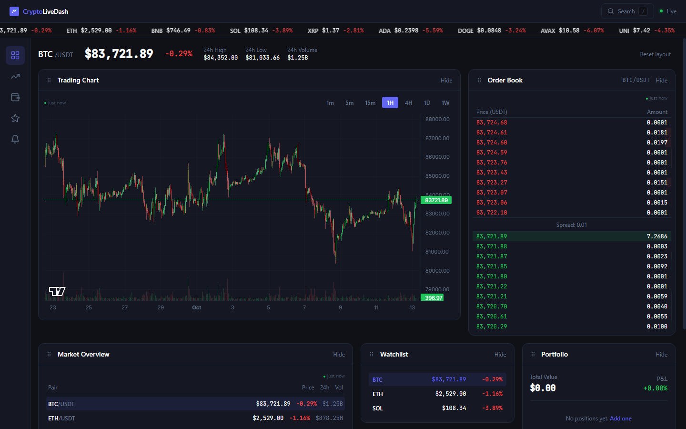

# CryptoLiveDash

Real-time cryptocurrency trading dashboard with live Binance market data, TradingView candlestick charts, an order book, portfolio tracking, price alerts and drag-and-drop widgets.



---

## Problem

Crypto traders need a fast, reliable dashboard that consolidates real-time market data, charting, and portfolio tracking into a single customizable interface — without the bloat and complexity of full exchange platforms.

## Solution

CryptoLiveDash is a React dashboard that streams live market data from Binance over WebSocket, renders TradingView candlestick charts and lets users arrange their workspace with drag-and-drop widgets. It uses the feature-based architecture common in production fintech admin applications.

## Architecture

```
┌─────────────────────────────────────────────────┐
│                   React App                      │
│  ┌──────────┐  ┌──────────┐  ┌───────────────┐  │
│  │  Router   │  │  Redux   │  │  RTK Query    │  │
│  │ (lazy)    │  │  Store   │  │  (REST cache) │  │
│  └──────────┘  └──────────┘  └───────────────┘  │
│        │              │               │          │
│  ┌─────┴──────────────┴───────────────┴──────┐  │
│  │              Feature Modules               │  │
│  │  Dashboard │ Market │ Chart │ Portfolio    │  │
│  │  Watchlist │ Alerts │ Order Book           │  │
│  └─────────────────────┬─────────────────────┘  │
│                        │                         │
│  ┌─────────────────────┴─────────────────────┐  │
│  │            Shared Layer                    │  │
│  │  useWebSocket │ Formatters │ Types │ UI   │  │
│  └───────────────────────────────────────────┘  │
└──────────────────────┬──────────────────────────┘
                       │
        ┌──────────────┴──────────────┐
        │      Binance API            │
        │  REST (historical data)     │
        │  WebSocket (live streams)   │
        └─────────────────────────────┘
```

## Key Technical Highlights

- **Live WebSocket streams** for all-market tickers (`!miniTicker@arr`) and per-symbol candles, with capped reconnects and a clean teardown when the symbol or timeframe changes
- **Redux Toolkit + RTK Query** for application state and cached REST data
- **Price alerts checked on every live price update** by a Redux listener middleware, whichever page is open, with browser notifications when allowed
- **TradingView Lightweight Charts**, with live candles applied through `update()` instead of re-setting the series, and sized to its container by a `ResizeObserver`
- **Drag-and-drop dashboard** with @dnd-kit, by mouse or keyboard; the layout is saved
- **Route-level code splitting** with `React.lazy`
- **Validated persistence**: portfolio, watchlist, alerts and layout are saved to localStorage and checked with Zod on load, so corrupted or tampered data falls back safely
- **179 automated tests** with Vitest and React Testing Library, and coverage gates in CI (see [Testing](#testing))
- **TypeScript** in strict mode, ESLint with the React Compiler rules, feature-based folder structure

## Tech Stack

| Category   | Technology                                 |
| ---------- | ------------------------------------------ |
| Framework  | React 19 + TypeScript 6                    |
| Build      | Vite 8 (Rolldown)                          |
| State      | Redux Toolkit + RTK Query                  |
| Charts     | TradingView Lightweight Charts 5           |
| Styling    | Tailwind CSS 4                             |
| DnD        | @dnd-kit                                   |
| Forms      | React Hook Form                            |
| Validation | Zod 4 (`zod/mini`) for the persisted state |
| Routing    | React Router 7                             |
| Testing    | Vitest 5 + React Testing Library           |
| CI         | GitHub Actions                             |

## Quick Start

Requires Node.js 22 or newer.

```bash
git clone https://github.com/arsen-react/CryptoLiveDash.git
cd CryptoLiveDash
npm install
npm run dev
```

Open [http://localhost:3000](http://localhost:3000) — no API keys needed.

## Features

### Dashboard

- Drag a widget by its handle with the mouse, or with the keyboard: Space to lift, arrow keys to move one place earlier or later, Space to drop
- Hide widgets and bring them back, or reset to the default layout
- The layout is saved in localStorage

### Trading Chart

- Candlestick charts (TradingView)
- Multiple timeframes (1m, 5m, 15m, 1H, 4H, 1D, 1W)
- Volume overlay
- Real-time candle updates via WebSocket

### Market Overview

- 20 major USDT pairs, sorted by 24h volume
- Live price updates
- 24h change and volume

### Portfolio Tracker

- Add positions, with the buy price pre-filled from the live price
- Real-time P&L calculation
- Total portfolio value and cost basis

### Watchlist

- Track favorite coins
- Live prices with 24h change

### Price Alerts

- Set above/below price targets
- Alerts fire on any page as soon as the live price reaches them
- Pause and resume alerts
- Browser notifications on trigger, when the browser allows them

## Testing

```bash
npm run test           # run all 179 tests
npm run test:coverage  # with the coverage report and thresholds
npm run check          # format check, lint, tests with coverage and build, as CI runs them
```

| Area                | What is tested                                                                                        |
| ------------------- | ----------------------------------------------------------------------------------------------------- |
| Redux slices        | add, update, remove, toggles, persistence, tampered storage, the alerts listener                      |
| RTK Query endpoints | USDT filtering, kline parsing, order-book mapping, request URLs                                       |
| Hooks               | WebSocket lifecycle, reconnects, latest-callback handling, debounce, localStorage                     |
| Screens             | dashboard (including keyboard drag and drop), chart, market, order book, portfolio, watchlist, alerts |
| Shell               | header search, sidebar, live-status reporting, every route, the not-found page, the app booting       |
| Utilities           | formatters, ticker mapping, class merging, Zod-validated storage                                      |

Coverage is about 97% of lines and 91% of branches. CI fails below 95% of statements and lines or 88% of branches and functions.

## Technical Challenges & Solutions

### Challenge 1: Binance retired the all-market ticker stream

The dashboard subscribed to `!ticker@arr`, which still accepts connections but no longer sends data. The status dot stayed green while the watchlist showed $0, portfolio values stopped updating and price alerts could never fire.

**Solution**: Switched to `!miniTicker@arr` and derived the 24h change from the open and close prices in `miniTickerToTicker`, which is unit-tested against a real Binance payload.

### Challenge 2: Old streams reconnecting after a symbol switch

Closing a socket during cleanup triggered its own reconnect logic, so switching from BTC to ETH re-opened the BTC stream in the background and its candles reached the ETH chart.

**Solution**: The hook now marks a socket as disposed on cleanup, cancels the pending reconnect and ignores late events. Two regression tests reproduce the original bug.

### Challenge 3: Price alerts that only fired on one page

Alerts were checked inside the Alerts page, so a target reached while the user watched the dashboard went unnoticed.

**Solution**: A Redux listener middleware checks the active alerts on every live price update, independent of the UI. Tests dispatch price updates to a store with no page mounted.

### Challenge 4: Keyboard reordering on a grid of mixed widths

dnd-kit's default keyboard handling moves a widget to the nearest one in the arrow's direction, which on a 12-column grid with wide and narrow widgets jumped to the next row.

**Solution**: A custom coordinate getter moves the widget one place earlier or later in the saved order. The test reproduces the real grid geometry.

### Challenge 5: Chart performance with 500+ candles

**Solution**: TradingView Lightweight Charts renders on canvas, and live candles are applied with `update()` instead of `setData()`, so a new tick never redraws the whole series.

### Challenge 6: Persisting state safely

**Solution**: Every slice loads its saved state through a Zod schema. Invalid or tampered data falls back to defaults, and a full storage quota logs a warning instead of crashing the app.

## Scripts

```bash
npm run dev            # Start dev server
npm run build          # Type-check and production build
npm run preview        # Preview production build
npm run lint           # ESLint check
npm run format         # Prettier format
npm run format:check   # Prettier check
npm run test           # Run tests
npm run test:watch     # Watch mode
npm run test:coverage  # Tests with coverage report and thresholds
npm run check          # Everything CI runs
```

## Project Structure

```
src/
├── app/              # Store, routes, App entry
├── features/         # Feature modules (dashboard, market, chart, etc.)
│   ├── dashboard/    # Drag-and-drop widget grid
│   ├── market/       # Market data, ticker, order book
│   ├── chart/        # TradingView chart integration
│   ├── portfolio/    # Portfolio tracking
│   ├── watchlist/    # Coin watchlist
│   └── alerts/       # Price alerts and the alert listener
├── shared/           # Reusable hooks, components, utils, types
├── styles/           # Tailwind theme and global styles
└── test/             # Vitest setup, render helper, fixtures
```

## License

MIT
